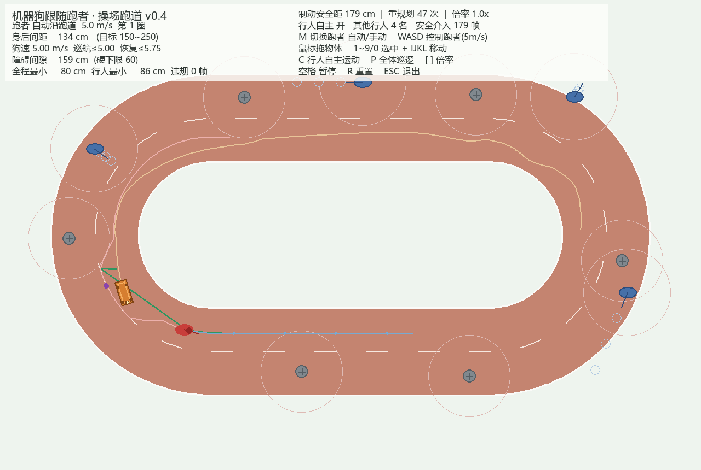

# luyaCar

跟人跑步的四足机器狗仿真。**当前版本 v0.4**：跑者以 5m/s 绕操场跑道跑，机器狗（70×35×40cm）保持身后约 2m，自动绕开 6 个静态路锥和 4 名自主运动的其他行人，且与任何对象保持 ≥60cm 安全距。



> **本次优化改了什么** → 工作区根目录的 [《优化说明_v0.4.md》](../优化说明_v0.4.md)：16 个 bug / 不真实之处逐条列出，附参数对照表与 7 场景验收数据。

## 快速开始

```bash
pip install -r requirements.txt    # 只需 pygame
python run.py                     # v0.4 机器狗跟随
python run.py --v02               # 回看 v0.2 蜿蜒路仿真
```

> Windows 上若 WorkBuddy 内置 Python 装不上 pygame，用 Anaconda：
> `C:/Tools/ananconda3/python.exe run.py`

打开窗口就自动开跑，**不需要任何操作**。分步说明见工作区的《如何运行luyaCar（临时）.md》。

## 场景与规则

| 项 | v0.4 设定 | 理由 |
|---|---|---|
| 跑者 | 5m/s，宽 50cm、高 1.7m，合速率恒定 | 绕障横移会吃掉前进分量 |
| 机器狗 | 70×35×40cm，胶囊碰撞体 | Go2 / B2 量级四足 |
| 跑道 | 2.4m 宽，操场形，一圈 35.3m | 1m 宽时狗与人无法错身 |
| 跟随间距 | 目标 200cm（150–250cm） | `d = v·t + v²/(2a) ≈ 179cm` 制动安全距 |
| 安全距 | 与路锥/行人 ≥60cm（期望 90cm） | 原需求 50–70cm 区间取中值 |
| 速度 | 巡航 ≤5m/s；掉队恢复 ≤5.75m/s | 同速追同速无法恢复队形 |
| 转向 | 最大角速度随速度从 3.0 衰减到 1.2 rad/s | 高速不能急打方向 |

**避碰对象**：6 个静态路锥（r=18cm）+ 4 名行人（同向慢走 / 对向走来 / 2 名横穿，r=25cm，1.5m/s）。行人会画出淡蓝色预测虚影；`C` 键可开关其自主运动。

## 操作

| 操作 | 作用 |
|------|------|
| `M` | 切换跑者：自动沿跑道 / 我用手操（速度都固定 5m/s） |
| `WASD` / 方向键 | 手动模式下控制跑者方向（速度不可调） |
| 鼠标左键拖动 | 推动任意路锥 / 行人（限速 5m/s） |
| `1`~`9` / `0` + `IJKL` | 选中并键盘移动某个对象（限速 5m/s） |
| `C` | 开/关 4 名行人的自主运动 |
| `P` | 全体对象沿跑道反向巡逻（5m/s） |
| `[` `]` | 播放倍率 0.25× / 0.5× / 1×（物理速度不变，便于观察） |
| `空格` / `R` / `ESC` | 暂停 / 重置 / 退出 |

## 技术要点

- **分层避碰**：A* 规划膨胀（硬禁区）→ 行人 1.2s 三点扫掠预测（软代价）→ 排斥转向 → TTC 提前减速 → **位移投影到安全集**（硬兜底）。最后一层只削减本帧位移、同步降速，不瞬移、物理可执行。
- **主人也是碰撞体**：被跟随的跑者以 45cm 硬下限进入位移投影层，转身折返或手动操控迎面跑来时不会穿模。
- **速度指令语义 = `/cmd_vel`**：`(v, omega)` 可直接迁到 ROS 2 真机。
- **胶囊体精确间隙**：点到狗中轴线段的距离扣双方半径，比外接圆更贴近长条形本体。
- **可验证**：`World` 自带 `violation_frames` / `teleport_frames` / `min_pedestrian_gap` 等统计，无头即可回归。

### 踩过的坑（择要，完整清单见优化说明）

- v0.3 用 `self.x += push` 直接改坐标「保证」零碰撞 —— 等于机器人凭空侧滑，真机做不到，数据无效。
- `max(0, cos(err))` 在朝向误差 >90° 时把速度乘成 0，狗原地冻结；纯追踪在 180° 误差时 `sin(err)→0` 又转不动，两个缺陷叠加成死锁。
- 行人预测区若标成硬禁区，4–5m 膨胀带会把 2.4m 跑道整个封死，A* 直接无解。
- 把对向行人放在内侧 `-95cm` 会堵死机器狗的内侧快车道，跟随中位从 207cm 恶化到 495cm。

## 项目结构

```
luyaCar/
├── run.py                      # 启动入口（--v02 回看旧版）
├── requirements.txt
├── cube_chase/                 # v0.4 机器狗跑步跟随（目录名沿用历史命名）
│   ├── config.py               # 全部可调参数（厘米制）+ 制动安全距公式
│   ├── track.py                # 操场跑道：胶囊几何 + 弧长参数化 + O(1) 反解
│   ├── person.py               # 跑者：自动/手操 + 轨迹回退 + 未来路线预测
│   ├── obstacles.py            # 路锥 + 其他行人（自主运动、轨迹预测、胶囊间隙）
│   ├── planner.py              # 动态栅格 A*：按实际半径膨胀 + 多点扫掠 + 引导代价
│   ├── dog.py                  # 机器狗：纯追踪 + 弧长控速 + 安全速度/位移层
│   └── simulation.py           # 场景、输入、渲染、验收统计
├── follow_dog/                 # v0.2 蜿蜒路仿真（保留）
└── _shots/                     # 效果图
```

## 验收数据（无头 5 圈 ≈ 35 秒，7 场景）

| 场景 | 跟距中位 / P90 (cm) | 障碍最小 | 行人最小 | 违规 | 瞬移 | 人狗最小 |
|---|---|---|---|---|---|---|
| 默认（行人自主） | 342 / 554 | 76.4 | 76.4 | 0 | 0 | 110 |
| 行人自主关闭（静态） | **217** / 324 | 78.4 | 84.3 | 0 | 0 | 110 |
| 全体巡逻（动态） | 340 / 555 | 62.4 | 67.7 | 0 | 0 | 96 |
| 手操跑者绕圈 | 77 / 264 | 70.0 | 75.9 | 0 | 0 | 55 |
| 障碍侧向扫过 | 523 / 778 | 73.2 | 74.1 | 0 | 0 | 106 |
| 障碍追着压（极端） | 413 / 1077 | 62.4 | 62.4 | 0 | 0 | 98 |
| 跑者中途急停 | 60 / 60 | 67.2 | 75.6 | 0 | 0 | 56 |

安全距硬下限 60cm，7 场景最小 62.4cm；机器狗最高速 5.75m/s（配置上限）。动态礼让时队形会暂时拉大，属「安全优先于队形」的预期行为。

**改完参数一键自检**：`python verify.py`（无头跑完 7 场景，有违规即以退出码 1 结束）。

## 路线图

1. ✅ v0.1 键盘控制人 + 差速小车跟随
2. ✅ v0.2 蜿蜒路 + A* 避障跟随 50cm
3. ✅ v0.3 操场跑道 + 5m/s + 动态障碍 + 人机双控
4. ✅ v0.4 真实机器狗尺寸 / 制动安全距 / 其他行人避碰 / 去掉瞬移作弊
5. ✅ 一键回归测试脚本 `verify.py`（7 场景，违规即退出码 1）
6. 障碍随机生成 / 加惯性、打滑、传感器噪声与延迟；四足步态
7. 迁移 ROS 2（`/cmd_vel`）→ Gazebo / 真机
