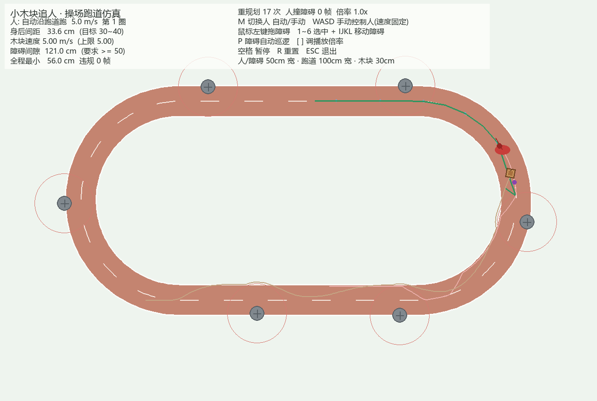

# luyaCar

跟人跑步的机器人仿真。**当前版本 v0.3：小木块在操场跑道上追人** —— 人 5m/s 绕圈跑，小木块以不超过人速的速度变换着追赶，自动规划路线绕开与人等大的障碍，并始终保持 50cm 以上安全距离。



## 快速开始

```bash
pip install -r requirements.txt    # 只需 pygame
python run.py                     # v0.3 小木块追人
python run.py --v02               # 回看上一版机器狗蜿蜒路仿真
```

> Windows 上若 WorkBuddy 内置 Python 装不上 pygame，用 Anaconda：
> `C:/Tools/ananconda3/python.exe run.py`

一键跑起来，**默认人自动沿跑道跑，不需要任何操作**。详细分步说明见工作区的《如何运行luyaCar（临时）.md》。

## 操作

| 操作 | 作用 |
|------|------|
| `M` | 切换人：自动沿跑道跑 / 我用手操（速度都固定 5m/s） |
| `WASD` / 方向键 | 手动模式下控制人的**方向**（速度不可调） |
| 鼠标左键拖动 | 推动障碍（限速 5m/s，不会瞬移） |
| `1`~`6` + `IJKL` | 选中某个障碍并用键盘移动它 |
| `P` | 开/关障碍自动巡逻（沿跑道反向 5m/s，演示动态避障） |
| `空格` / `R` / `ESC` | 暂停 / 重置 / 退出 |
| `[` `]` | 播放倍率 0.25× / 0.5× / 1×（物理速度仍是 5m/s，只是慢放便于观察） |

## 规则逐条对照

| # | 规则 | 实现方式 | 验收 |
|---|------|----------|------|
| 1 | 人高1.7m宽50cm、木块30cm立方、跑道宽100cm | 全部用**厘米**建模，`SCALE=1.5cm/px` 只管渲染 | 跑道 100cm、人/障碍半径 25cm、木块外接圆 21.2cm |
| 2 | 保持在人身后 30~40cm | 沿人真实轨迹回退 81cm（= 两人半径 + 35cm 表面间距），用**弧长误差**控速 | 5 圈中位 **36cm**、P90 49cm |
| 3 | 速度不超人；可走最近路线；预测未来走向 | 速度硬上限 = 人速 5m/s；A* 求最短路（弯道切内线）；`future_route()` 预测人未来 7m 路线并追加到规划路径 | 全程最高速 **5.00m/s**（从未超） |
| 4 | 障碍足够多，人不能走直线 | 6 个障碍从外侧半探入跑道，人每个都要内让一次再回中，跑成波浪线 | 人轨迹呈 S 形，人撞障碍 0 帧 |
| 5 | 木块离障碍 ≥50~70cm | 规划层膨胀硬约束 + 控制层排斥转向 + CBF 安全过滤层 + 实体约束 | 全程最小 **52~56cm**，违规 **0 帧** |
| 6 | 人可自动跑 / 我来操作，速度固定 | `M` 切换；自动模式遇障自动侧移，手动模式只改方向 | 两种模式均验证 |
| 7 | 障碍与人同大小、可控制移动、速度与人一致 | 半径同为 25cm；拖动 / IJKL / 巡逻三种控制，均限速 5m/s | 巡逻与拖动场景规则5 仍成立 |

## 设计要点（踩坑实录）

- **人的"速度固定"必须是合速率固定**：绕障碍横移要花掉一部分速度，沿跑道前进分量变成 `sqrt(500² - v_lat²)`，人会变慢。这正是规则3 能成立的物理前提——木块走平滑最短路，同样 5m/s 全用于前进，才追得上。
- **障碍不能左右交错**：6 个障碍交替摆两侧时，木块每圈要横穿跑道 6 次（横向路程 >10m），速度全耗在打方向上，实测稳定掉队 3~5m。改成全部从外侧探入后存在一条"内侧快车道"，中位间距立刻从 350cm 降到 31cm。
- **初速必须给满**：若木块从 0 起步，加速的 0.2s 被拉开约 80cm，而它又不能超速，这个差距一辈子追不回来。
- **路径终点必须是"跟随点"本身**：设到人前方会让 A* 直接横穿操场去那个点；但路径又不能到跟随点就结束（会掉头打转），所以再沿预测路线追加一段延伸段。
- **移动目标要前滑补偿**：路径每 0.18s 才重规划，跟随点却以 5m/s 移动，不作补偿木块会周期性"追上一个静止旧目标"然后减速。
- **排斥范围别开太大**：规划膨胀后木块正常巡航离障碍就有 80cm，排斥范围设 170cm 等于全程开启，转向饱和、原地打转。
- **安全过滤层（CBF）**：规划留的余量会被纯追踪切弯啃掉几 cm，最后用"投影回安全集"的硬修正守住 50cm；再加"障碍不能压进木块安全圈"的实体约束，避免同速下被障碍追着撞时互相穿透。

## 项目结构

```
luyaCar/
├── run.py                      # 启动入口（--v02 回看旧版）
├── requirements.txt
├── cube_chase/                 # v0.3 小木块追人
│   ├── config.py               # 所有可调参数（厘米制，集中管理）
│   ├── track.py                # 操场跑道：胶囊几何 + 弧长参数化 + O(1) 反解
│   ├── person.py               # 人：自动避障 / 手动操控 + 轨迹回退 + 未来路线预测
│   ├── obstacles.py            # 障碍：与人等大、限速移动、巡逻、拖动
│   ├── planner.py              # 动态栅格 A*：膨胀禁区 + 障碍预测 + 弱引导代价 + 平滑
│   ├── cube.py                 # 木块：运动学 + 纯追踪 + 弧长控速 + 安全过滤层
│   └── simulation.py           # 场景、输入、渲染、统计
└── follow_dog/                 # v0.2 机器狗蜿蜒路（保留）
```

## 验收数据（无头回归，5 圈 ≈ 35 秒）

| 场景 | 身后间距中位 | 全程最小障碍间隙 | 违规帧 | 木块最高速 |
|------|--------------|------------------|--------|------------|
| 静态障碍 | 36cm | 56.0cm | 0 | 5.00m/s |
| 障碍自动巡逻 | 26cm | 52.0cm | 0 | 5.00m/s |
| 手动操控人 | 36cm | 56.0cm | 0 | 5.00m/s |
| 拖动障碍侧向扫过 | 117cm | 52.0cm | 0 | 5.00m/s |
| 障碍一直压着木块（极端对抗） | 623cm | 52.0cm | 0 | 5.00m/s |

> 规则5 在所有场景恒成立。规则2 用"尽可能"描述：正常场景稳定在 30~40cm；
> 用户把障碍一直怼在木块身上时，木块优先保安全距，必然暂时掉队。

## 路线图

1. ✅ v0.1 键盘控制人 + 差速小车跟随
2. ✅ v0.2 蜿蜒路 + A* 避障跟随 50cm（零碰撞）
3. ✅ v0.3 操场跑道 + 5m/s + 动态障碍 + 人机双控（当前）
4. 障碍随机生成 + 自动回归测试脚本
5. 木块改成四足步态 / 加惯性、打滑、传感器噪声
6. 迁移 ROS 2（`/cmd_vel` 语义预留）→ Gazebo / 真机
